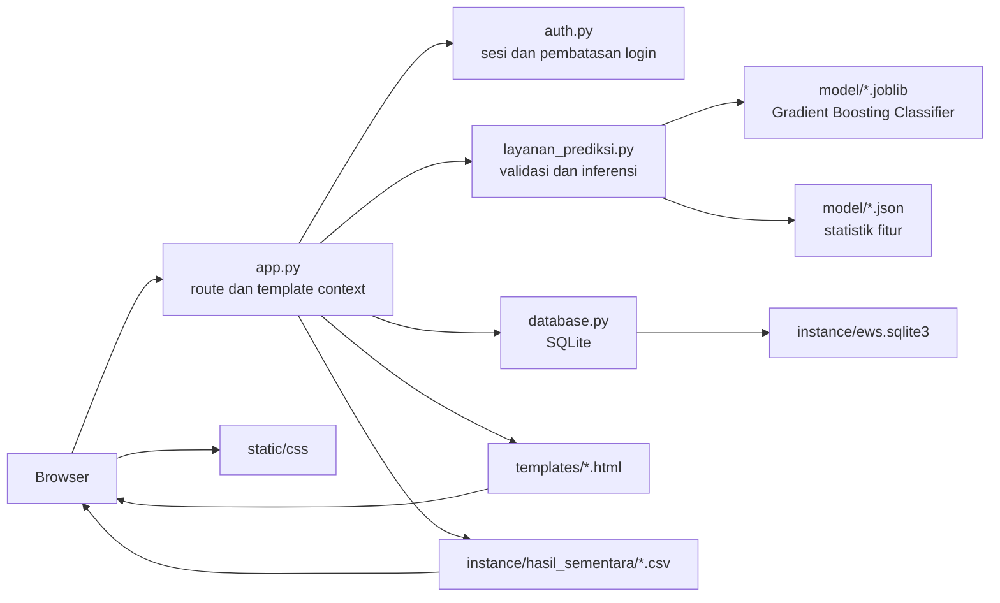

# Arsitektur Proyek

Panduan ini merangkum struktur dan alur data **Early Warning System Akademik**.
Implementasi utama adalah aplikasi Flask dengan HTML yang dirender di server;
proyek belum memisahkan route, layanan, dan akses basis data menjadi package.

## Gambaran arsitektur



`create_app()` di `app.py` memuat konfigurasi, model dan statistik, kamus kode
opsional, membuat tabel SQLite, lalu mendaftarkan route. Instance
`LayananPrediksi` dibuat sekali saat aplikasi mulai dan digunakan bersama oleh
route prediksi.

## Peta folder dan file

| Lokasi | Tanggung jawab |
| --- | --- |
| [`app.py`](../app.py) | Application factory, konfigurasi awal, route Flask, pemrosesan input web, penyimpanan hasil, pembuatan unduhan, dan pemilihan template. |
| [`auth.py`](../auth.py) | Dekorator `login_wajib` untuk autentikasi/otorisasi berbasis peran serta pembatasan percobaan login per alamat IP. |
| [`config.py`](../config.py) | Nilai konfigurasi dari environment dan lokasi database serta aset model. |
| [`database.py`](../database.py) | Inisialisasi skema dan operasi SQLite untuk riwayat prediksi, profil mahasiswa, dan tindak lanjut. |
| [`layanan_prediksi.py`](../layanan_prediksi.py) | Batas logika model: validasi data, prediksi, kategori, faktor dominan, serta rekomendasi. |
| `model/` | Artefak aktif `ews_gb_v2.1.joblib` dengan statistik `statistik_fitur_v2.1.json` (15 fitur), serta artefak versi sebelumnya. Model sudah dilatih; aplikasi memuatnya, bukan melatih ulang. |
| `templates/` | Tampilan Jinja2: `base.html` sebagai layout bersama; halaman login, beranda per peran, formulir individu, unggah, hasil, riwayat, daftar/detail mahasiswa, dan galat. `_kepentingan_model.html` adalah partial untuk visualisasi kepentingan fitur. |
| `static/css/` | Gaya antarmuka. `tokens.css` mendefinisikan token desain dan `app.css` memuat gaya komponen/halaman. |
| `tests/` | Tes pytest: `test_app.py` untuk route dan perilaku web; `test_database.py` untuk skema dan fungsi penyimpanan/query. |
| `contoh_uji/` | CSV contoh untuk demo dan pengujian unggahan, termasuk contoh valid dan rusak. |
| `instance/` | Data runtime lokal yang dibuat/digunakan aplikasi: `ews.sqlite3` dan `hasil_sementara/` untuk berkas CSV unduhan sementara. Umumnya bukan source control. |
| `docs/` | Dokumentasi proyek; file ini adalah peta arsitektur. |
| `.github/` | Konfigurasi/metadata integrasi GitHub. |
| [`README.md`](../README.md) | Persyaratan, cara menjalankan, penggunaan, dan tes. |
| [`requirements.txt`](../requirements.txt) | Dependensi runtime dan pengujian Python aplikasi. |
| [`copilot-instructions.md`](../copilot-instructions.md) | Aturan kerja agent. Perhatikan perbedaan perilaku privasi yang dijelaskan di bagian berikut. |

`kamus_kode.json` di root adalah konfigurasi opsional: `config.py` memberi
lokasinya dan `app.py` memuatnya bila ada. Direktori lingkungan virtual, cache,
dan `__pycache__` bukan bagian dari source aplikasi.

## Alur data

### 1. Inisialisasi

1. `create_app()` membaca `Config` dan override yang diberikan untuk tes.
2. `LayananPrediksi` memuat model Joblib dan statistik fitur JSON.
3. Statistik model digunakan untuk validasi rentang serta nilai awal/minimum/
   maksimum input. Daftar fitur model (`layanan.fitur`) menjadi sumber utama
   urutan dan nama fitur; jangan menduplikasi daftar fitur sebagai konstanta
   untuk seluruh model.
4. `init_db()` membuat atau memperbarui tabel SQLite. Berkas database dan
   direktori hasil sementara dibuat pada lokasi yang dikonfigurasi.
5. Kata sandi dari environment di-hash untuk proses login; konfigurasi
   CSRFProtect dan handler galat dipasang.

### 2. Akses dan pemilihan halaman

- `POST /login` memeriksa peran dan kata sandi. Sesi menyimpan peran
  (`dosen_wali` atau `staf_akademik`); login dibatasi oleh `PembatasPercobaanLogin`.
- `login_wajib()` melindungi route yang memerlukan sesi masuk dan memeriksa
  peran khusus pada prediksi individu, unggah, daftar, dan detail mahasiswa.
- Route di `app.py` mengambil data melalui fungsi `database.py`, lalu
  mengirimkannya ke template Jinja2. Template menggunakan `base.html` dan
  stylesheet dari `static/css/`.

### 3. Prediksi satu mahasiswa

```mermaid
sequenceDiagram
    participant B as Browser
    participant A as app.py
    participant L as LayananPrediksi
    participant M as Model
    participant D as database.py / SQLite
    B->>A: POST /individu (fitur dan identitas opsional)
    A->>A: Bentuk DataFrame sesuai urutan fitur model
    A->>L: proses(DataFrame)
    L->>L: Validasi kolom dan nilai; kumpulkan galat/peringatan
    L->>M: Prediksi, faktor dominan, dan rekomendasi
    M-->>L: Nilai prediksi
    L-->>A: hasil, galat, peringatan
    A->>D: Simpan hasil; perbarui profil bila ID tersedia
    A-->>B: Render hasil_individu.html
```

Jika input tidak valid, `layanan_prediksi.py` mengembalikan galat dan route
menampilkan pesan pada formulir tanpa menyimpan prediksi. Nilai di luar rentang
statistik latih atau kode kategori yang tidak dikenal menjadi peringatan, bukan
penghenti prediksi. Formulir menyediakan delapan fitur utama; tujuh fitur lainnya diisi dengan nilai
awal dari statistik model kecuali pengguna membuka dan mengubah bagian lanjutan.

### 4. Prediksi batch CSV

1. Staf mengunduh header/template CSV melalui `GET /unggah/template`.
2. `POST /unggah` memeriksa ekstensi, batas ukuran (2 MB), batas baris (2000),
   header, encoding, dan kelengkapan data. Kolom `id_mahasiswa` dan
   `nama_mahasiswa` bersifat opsional, tetapi nama tidak boleh diberikan tanpa
   ID.
3. `app.py` membaca CSV menjadi DataFrame pandas dan memanggil
   `LayananPrediksi.proses()`, sama seperti jalur formulir.
4. Tiap baris hasil disimpan sebagai riwayat sumber `csv`. Bila tersedia,
   identitas dan fitur input juga memperbarui profil mahasiswa.
5. Hasil ditampilkan di `unggah.html`; salinan CSV hasil disimpan sementara di
   `instance/hasil_sementara/<uuid>.csv`. Sesi menyimpan UUID batch untuk
   `GET /unduh`. Berkas lama dibersihkan setelah satu jam, dan berkas milik sesi
   dihapus saat logout atau diganti oleh unggahan baru.

### 5. Pemrosesan di layanan prediksi

`LayananPrediksi.proses(df)` menjalankan langkah berikut:

1. Menormalkan nama kolom dan memastikan semua fitur model tersedia.
2. Mengonversi fitur menjadi numerik; input kosong atau non-numerik menghentikan
   proses. Nilai di luar rentang dan kode kategorikal yang tidak ada di data latih
   menghasilkan peringatan.
3. Memanggil model untuk menghasilkan nilai prediksi. Kategori adalah
   **Berisiko** jika nilai mentah di bawah ambang model; selain itu
   **Normal**.
4. Membandingkan fitur penjelas terhadap median data latih untuk menghitung
   faktor dominan. Ini adalah penjelasan berbasis substitusi, bukan klaim sebab
   akibat.
5. Membentuk rekomendasi dari kategori, faktor, dan aturan untuk status
   pembayaran/tunggakan/beasiswa. Hasil berisi nilai prediksi, kategori,
   peringkat, faktor, dan rekomendasi.

Prediksi adalah dukungan keputusan, bukan keputusan otomatis. Logika model,
validasi, kategori, faktor, dan rekomendasi milik `layanan_prediksi.py`; route
sebaiknya hanya menyiapkan input, menangani keluaran, dan mengatur tampilan.

Aplikasi menggunakan `ews_gb_v2.1.joblib` dan
`statistik_fitur_v2.1.json`. Keduanya mendefinisikan 15 fitur yang sama; daftar
dan urutannya bersumber dari metadata model, sedangkan statistik menjadi sumber
rentang validasi dan nilai awal formulir.

## Penyimpanan data

`database.py` mengelola tiga tabel utama:

- `riwayat_prediksi`: waktu, pseudonim, versi model, nilai/kategori prediksi,
  faktor, rekomendasi, sumber (`formulir`/`csv`), UUID batch, dan peran.
- `mahasiswa`: ID internal, ID mahasiswa, pseudonim, nama, waktu pembaruan, dan
  JSON fitur input terbaru. Profil diperbarui ketika prediksi menyertakan ID.
- `tindak_lanjut`: status, catatan, waktu pembaruan, dan peran pembaru; terkait
  ke profil mahasiswa.

Riwayat dan dashboard memilih prediksi terbaru per pseudonim untuk ringkasan
profil; daftar riwayat umum dapat difilter berdasarkan kategori dan sumber.
Pseudonim dibuat dari SHA-256 atas `SALT_ID + id_mahasiswa`, dipotong menjadi
12 karakter.

**Catatan privasi untuk agent:** pseudonim bukan berarti ID asli tidak tersimpan.
Implementasi `database.simpan_hasil()` saat ini menyimpan `id_mahasiswa` dan
`nama_mahasiswa`/`nama` dalam tabel `mahasiswa` sebagai teks biasa, serta
menyimpan fitur input terbaru sebagai JSON. Ini sesuai keterangan README, tetapi
bertentangan dengan aturan di `copilot-instructions.md` yang menyatakan agar
nama tidak disimpan dan ID hanya disimpan dalam bentuk hash. Jangan menganggap
data tersebut sudah anonim; perubahan kebijakan penyimpanan perlu menyelaraskan
kode, dokumentasi, dan aturan agent.

## Panduan navigasi untuk perubahan

- Perubahan route, validasi input HTTP, sesi, atau pemilihan template: mulai dari
  `app.py`; tambahkan/perbarui tes di `tests/test_app.py`.
- Perubahan skema, query, persistensi, atau data profil: `database.py` dan
  `tests/test_database.py`.
- Perubahan inferensi atau interpretasi model: ikuti batas yang ditetapkan di
  `copilot-instructions.md`; jangan mengubah `layanan_prediksi.py` tanpa
  permintaan eksplisit.
- Perubahan tampilan: template terkait di `templates/`, lalu token/gaya di
  `static/css/`.
- Jalankan tes dengan `python -m pytest` dari root proyek.
